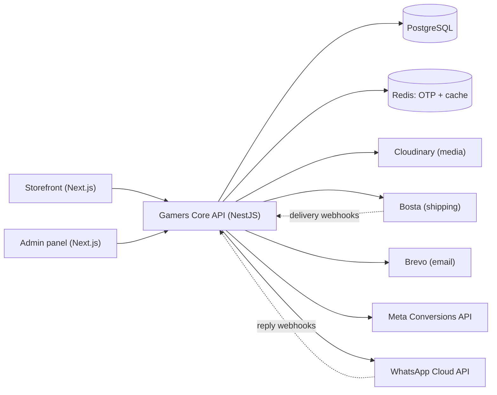

# Gamers Core Backend

REST API behind [Gamers Core](https://gamers-core.net), a live bilingual (Arabic/English) e-commerce platform built for a gaming-accessories business in Egypt. It replaced a manual Shopify workflow: customers are verified, orders are confirmed over WhatsApp, and Bosta deliveries are created automatically. The owner now only completes delivered orders and handles customer support.

**Live API:** [api.gamers-core.net](https://api.gamers-core.net)

**Part of Gamers Core:** [Storefront](https://github.com/Gamers-Core/frontend) · [Admin panel](https://github.com/Gamers-Core/admin) · **Backend (this repo)**

<!-- Add 1–2 screenshots to docs/screenshots/ (no real customer data), e.g. an API request in Postman or the admin orders page. -->

## Highlights

- **Order lifecycle:** typed status and payment state machines with transition guards, an `OrderStatusHistory` audit trail, automatic cancellation of stale pending orders, and inventory restocking on cancellation.
- **Order automation:** email OTP sign-in with attempt and resend limits, WhatsApp confirm-or-cancel replies, Bosta city/district lookup at checkout, and automatic Bosta delivery creation on confirmation.
- **Discounts engine:** variant targeting, best automatic discount selection, free shipping, and usage tracking.
- **Server-side tracking:** Meta Conversions API for purchase events, with customer data hashed.
- **Bilingual API:** localized responses, validation errors and email templates (English/Arabic) driven by the `x-locale` header.
- **Safe deploys:** versioned TypeORM migrations (no schema sync), Zod-validated configuration per environment, and GitHub Actions CI on every push and pull request.

## Architecture



**Stack:** NestJS 11, TypeScript, PostgreSQL, TypeORM, Redis, Zod, cookie sessions. Deployed on Railway with Neon (PostgreSQL).

## Contents

- [Getting started](#getting-started)
- [Configuration](#configuration)
- [Running the application](#running-the-application)
- [Code organization](#code-organization)
- [API surface](#api-surface)
- [Database and migrations](#database-and-migrations)
- [Integrations](#integrations)
- [Testing, CI and quality checks](#testing-ci-and-quality-checks)
- [Operational notes](#operational-notes)
- [Project conventions](#project-conventions)

## Getting started

### Prerequisites

- Node.js 22 (the frontends and CI use `22.18.0`) and npm
- PostgreSQL
- Redis
- Credentials for the external services required by the environment you are running

### Install and run

```bash
npm install
```

Create `.env.local` (environment files are ignored by Git) and fill in the variables listed under [Configuration](#configuration). For a local setup that works with the frontends in this project, use a dedicated port:

```dotenv
PORT=8000
```

Then start the API:

```bash
npm run start:dev
```

The server listens on `PORT` (default `3000`). Use `8000` locally so it does not collide with the storefront (`3000`) and admin panel (`3001`).

## Configuration

Configuration is loaded from `.env.<NODE_ENV>` and validated with Zod at startup. Supported environments are `local`, `development`, `staging` and `production`. A missing or unknown `NODE_ENV` falls back to `development`; `npm run start:dev` explicitly selects `local`.

### Required in every environment

| Variable                | Purpose                                         |
| ----------------------- | ----------------------------------------------- |
| `NODE_ENV`              | Runtime environment name                        |
| `PORT`                  | HTTP port; defaults to `3000` during validation |
| `DATABASE_URL`          | PostgreSQL connection URL                       |
| `COOKIE_KEY`            | Secret used to sign cookie sessions             |
| `REDIS_URL`             | Redis connection URL                            |
| `BOSTA_TOKEN`           | Bosta API token                                 |
| `CLOUDINARY_CLOUD_NAME` | Cloudinary cloud name                           |
| `CLOUDINARY_API_KEY`    | Cloudinary API key                              |
| `CLOUDINARY_API_SECRET` | Cloudinary API secret                           |
| `FRONTEND_URL`          | Storefront URL                                  |
| `ADMIN_FRONTEND_URL`    | Administration frontend URL                     |

### Environment-specific variables

| Environment   | Additional variables                                                                                                                                                                    |
| ------------- | --------------------------------------------------------------------------------------------------------------------------------------------------------------------------------------- |
| `local`       | None                                                                                                                                                                                    |
| `development` | `COOKIE_DOMAIN`                                                                                                                                                                         |
| `staging`     | `COOKIE_DOMAIN`, `BREVO_API_KEY`, `EMAIL_USER`, `EMAIL_PASS`                                                                                                                            |
| `production`  | All staging variables plus `WHATSAPP_PHONE_NUMBER_ID`, `WHATSAPP_TOKEN`, `WHATSAPP_WEBHOOK_SECRET`, `WHATSAPP_APP_SECRET`, `BOSTA_WEBHOOK_SECRET`, `META_PIXEL_ID`, `META_ACCESS_TOKEN` |

Never commit credentials. Keep local values in `.env.local` and provide deployment values through the hosting platform's secret configuration.

## Running the application

```bash
npm run start:dev      # development with watch mode and local configuration
npm run build          # compile TypeScript into dist/
npm run start          # run the compiled default entry point
npm run start:staging  # run the compiled app with staging configuration
npm run start:prod     # run the compiled app with production configuration
```

The app starts with raw request bodies enabled (needed for webhook signature checks), credentialed CORS and proxy support. Outside `local`, cookie sessions are secure and use `sameSite: none`, so set `COOKIE_DOMAIN` correctly when the frontends and API are on related domains.

## Code organization

The code is organized by feature under [`src/`](src/):

- **Catalog:** products, variants, categories, brands, featured variants and media
- **Commerce:** cart, checkout, orders, addresses and discounts
- **Identity:** users, OTP sign-in, cookie sessions and admin access
- **Content:** FAQs, policies, settings, sidebar statistics and user reviews
- **Platform:** localization, Redis caching, scheduled jobs, exception handling and validation
- **Integrations:** Cloudinary, Bosta, Brevo, WhatsApp Cloud API and Meta Conversions API

Application-wide behavior is wired in [`src/app.module.ts`](src/app.module.ts): Zod environment validation, TypeORM/PostgreSQL, global DTO validation (unknown properties removed), global authentication and maintenance-mode guards, seven-day cookie sessions, request locale context with translated domain exceptions, and scheduled tasks.

The global auth guard resolves `req.session.userId` and attaches the current user to the request. Customer routes use the current session; admin controllers under `/admin` require an authenticated admin. OTP state lives in Redis, and sign-in completes by storing the user ID in the session.

## API surface

Routes come directly from controller decorators; there is no global `/api` prefix. Responses are serialized through DTOs. Paginated responses use a `{ data, meta }` shape (default page `1`, limit `20`, maximum `100`).

### Storefront and customer routes

| Area                | Base path            |
| ------------------- | -------------------- |
| Authentication      | `/auth`              |
| Products            | `/products`          |
| Categories          | `/categories`        |
| Brands              | `/brands`            |
| Featured variants   | `/featured-variants` |
| Cart                | `/cart`              |
| Orders and checkout | `/orders`            |
| Addresses           | `/addresses`         |
| Discounts           | `/discounts`         |
| Media               | `/media`             |
| Users               | `/users`             |
| FAQs                | `/faqs`              |
| Policies            | `/policies`          |
| Settings            | `/settings`          |
| Reviews             | `/user-reviews`      |

Authentication endpoints:

```text
POST /auth/signin
POST /auth/admin/signin
POST /auth/verify-otp
POST /auth/resend-otp
POST /auth/logout
```

### Administration routes

```text
/admin/products
/admin/categories
/admin/brands
/admin/orders
/admin/users
/admin/discounts
/admin/faqs
/admin/featured-variants
/admin/policies
/admin/settings
/admin/user-reviews
/admin/sidebar/stats
```

The API supports English and Arabic. Clients send `x-locale`; the API exposes `x-locale` and `x-is-logged-in` response headers.

## Database and migrations

TypeORM connects to PostgreSQL via `DATABASE_URL`, using the snake-case naming strategy and entities discovered under `src/**/*.entity.ts`. Schema synchronization is disabled, and pending migrations run automatically at startup, so a deploy can change the database as part of application boot.

Migration files live in [`migrations/`](migrations):

```bash
# Generate a migration from entity changes (local configuration)
npm run migration:generate -- migrations/DescribeTheChange

# Apply pending migrations (production configuration)
npm run migration:run
```

Review generated migrations before applying them.

## Integrations

- **Redis:** OTP sessions and application caching (`REDIS_URL`).
- **Cloudinary:** media uploads, transformations and deletion; draft media cleanup runs on a schedule.
- **Bosta:** cities, districts, shipping fees, pickup locations, delivery operations and delivery webhooks.
- **Brevo:** transactional email in staging and production.
- **WhatsApp Cloud API:** order confirmation messages, replies and webhook handling (signature-verified) in production.
- **Meta Conversions API:** purchase and other conversion events in production.

External credentials are validated before the matching environment starts. Local and development OTP flows intentionally relax email delivery and OTP comparison checks; staging and production enforce them.

## Testing, CI and quality checks

The main quality gate is:

```bash
npm test
```

It runs TypeScript compilation, ESLint and Prettier in check mode (it does not invoke Jest). Other commands:

```bash
npm run lint
npm run format
npx jest --config test/jest-e2e.json   # existing end-to-end test
```

Tests that import `AppModule` need the required environment variables and reachable PostgreSQL and Redis instances, because initialization validates configuration and connects to infrastructure.

**CI:** GitHub Actions runs on every push and pull request for `dev`, `staging` and `master`. It runs `npm run test`, then `npm run build`.

## Operational notes

- CORS allows localhost origins when `COOKIE_DOMAIN` is absent; otherwise it allows subdomains of `COOKIE_DOMAIN`.
- Sessions are HTTP-only. Local cookies use `sameSite: lax` and are not secure; other environments use secure cross-site cookies.
- Maintenance mode is enforced globally; admin routes and explicitly exempt routes keep working.
- `npm run start` runs the compiled file at `dist/src/main.js`, so build first.

## Project conventions

1. Keep controllers thin and put business logic in feature services.
2. Add or update DTO validation and serialization with every API change.
3. Use translated exception keys for domain errors.
4. Keep multi-step writes transactional and use the existing optional manager helpers.
5. Add a TypeORM migration for every schema change; never enable synchronization.
6. Keep integration and environment checks in the existing config and helper modules.

## Technology references

[NestJS](https://docs.nestjs.com/) · [TypeORM](https://typeorm.io/) · [PostgreSQL](https://www.postgresql.org/docs/) · [Redis](https://redis.io/docs/)
